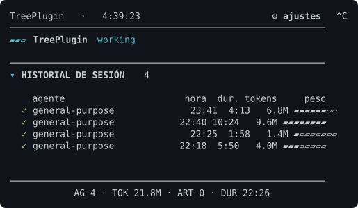

# Agents Tree

Subagent visibility for agent CLIs (Claude Code, Codex, Pi) inside [Herdr](https://herdr.dev).

[](https://github.com/SpidySamurai/herdr-agents-tree/actions/workflows/ci.yml)
[](LICENSE)


Agents Tree is a Herdr plugin that shows what your agent's subagents are doing:
a compact tree in the sidebar and a dashboard pane with the live tree, the
session history, published artifacts and a summary footer. It is driven
entirely by the agent CLI's lifecycle hooks, so it never reads a terminal,
never polls and needs no API keys.



<sub>Generated, not hand-drawn: `python3 scripts/capture-preview.py` renders one
real frame through the panel's own `render_frame()`, so the preview cannot show
a layout the code no longer produces.</sub>

## Features

- **A sidebar tree** of live subagents, published as Herdr metadata tokens. It
  never overwrites Herdr's own agent state.
- **A dashboard pane** with the live tree, session history, published
  artifacts and a footer summary.
- **Per-subagent history**: duration, token cost, model and reasoning effort
  for every delegation that finished, with a weight gauge that shows *which*
  one was expensive.
- **An artifact log** of every real publish, clickable from the panel.
- **Hook-driven only.** No terminal reads, no polling, no API keys.

Recognized agents are **Claude Code**, **Codex** and **Pi**. Anything Herdr
detects as something else is left alone rather than guessed at, so an
unrelated session's history and artifacts never leak into the panel.

## Quick start

### Requirements

- **Herdr 0.8+** (the plugin system).
- **Python 3.10+** on `PATH`. No build step and no dependencies: the plugin is
  plain Python.
- **Linux**, because the hooks use `fcntl` file locking.
- **At least one recognized agent CLI**: Claude Code, Codex or Pi.

What each runtime can prove differs, and the panel never claims more than its
source supports:

| Runtime | Presence | Live activity | Session end |
| --- | --- | --- | --- |
| Claude Code | full hook coverage | complete (every child accounted for) | supported |
| Codex | hook-compatible wiring only | partial (reuses Claude's payload shape) | unsupported (unverified) |
| Pi (companion extension) | its own top-level session only | partial (its own tool calls, not nested delegation) | supported (its own native event) |

### Install

```sh
herdr plugin install SpidySamurai/herdr-agents-tree
```

Herdr registers the plugin, and the plugin's startup hook wires itself into
each agent settings file it finds. There is no separate install step.

Then:

1. **Bind a key.** Herdr has no menu or palette for plugin actions, so add the
   binding yourself (see [Keybindings](#keybindings)).
2. **Restart your agent CLI.** A running session keeps the hook paths it
   started with.
3. **Open the dashboard.** With no agent running you get the idle screen. Start
   a session and delegate once, and the tree fills in.

<details>
<summary><b>What gets wired, and where</b></summary>

The startup hook adds these entries to `~/.claude/settings.json`, to the
`settings.json` of every extra Claude profile you configure (see
[Claude profiles](#claude-profiles)), and to `~/.codex/hooks.json`, whichever
of them exist:

| Event | Script | What it feeds |
| --- | --- | --- |
| `SessionStart` | `claude_profile_hook.py` | the session, its profile and start time |
| `SessionEnd` | `claude_profile_hook.py` | the end marker (see [When the session ends](#when-the-session-ends)) |
| `SubagentStart` | `claude_subagent_hook.py` | the live tree |
| `SubagentStop` | `claude_subagent_hook.py` | the session history |
| `PostToolUse` | `claude_artifact_hook.py` | published artifacts |

A profile directory with no `settings.json` is one you do not use, so it is
skipped rather than created. Each file is backed up once as
`<name>.agents-tree.bak` before its first edit, and the wiring never touches a
hook it did not add.

The wiring is idempotent and re-checked at every Herdr start, so it also
**self-heals**: reinstalling the plugin replaces Herdr's managed checkout, and
the next start points the hooks at the new path on its own.

</details>

### Claude profiles

`~/.claude` is always wired. If you run more than one Claude Code profile (each
with its own `CLAUDE_CONFIG_DIR`), name the extra ones in either place:

```sh
export AGENTS_TREE_CLAUDE_PROFILES=".claude-work:.claude-client"
```

```json
{ "claude_profiles": [".claude-work", "~/profiles/claude-client"] }
```

The JSON goes in the plugin's `config.json`
(`$XDG_STATE_HOME/herdr/claude-vezmex-team-tree/config.json`). Entries are
relative to `$HOME`, `~/` paths or absolute paths, and both sources are merged.
The variable has to be visible to Herdr for the startup hook to see it, so the
config file is the more reliable of the two. Removing the plugin
(`install.py --uninstall`) cleans every `~/.claude*` directory, so a profile
you stopped listing is never left wired.

### Keybindings

`~/.config/herdr/config.toml`:

```toml
[[keys.command]]
key = "prefix+alt+a"
type = "shell"
command = "herdr plugin action invoke open-dashboard --plugin spidysamurai.agents-tree"
description = "open the Agents Tree dashboard"
```

The plugin also ships the `refresh-agent-tree`, `configure-dashboard` and
`install-profile-resume` actions, bindable the same way.

### Updating

There is no `plugin update` in Herdr v1, so reinstall to refresh:

```sh
herdr plugin install SpidySamurai/herdr-agents-tree
```

Your settings survive: they live in the plugin's state directory, not in the
checkout.

### Removing

```sh
herdr plugin uninstall spidysamurai.agents-tree
```

To also unwire the agent hooks, run `python3 install.py --uninstall` from the
checkout before uninstalling. It removes only what this plugin wrote and
records that you opted out, so a later start does not silently re-wire you.

## How it works

### How the tree is joined

The dashboard never runs `herdr pane read` or any other terminal read. Herdr
locates the agent pane and supplies its session identifier. The tree then comes
entirely from local hook state:

- `SubagentStart`: `{session_id, agent_id, agent_type}` becomes a working row
  with a spinner.
- `SubagentStop`: `{session_id, agent_id, agent_type, ...}` marks it done.

Claude documents that these payloads keep the parent session's `session_id`,
and Herdr records that ID as the pane's `agent_session.value`. That exact match
is the join key. Each child is labelled with its agent type and a short suffix
of its event ID.

Live children are read through one shared layer, `src/runtime_observability/`,
that normalizes Claude Code, Codex and Pi evidence into a single snapshot. See
[docs/runtime-observability.md](docs/runtime-observability.md) for its design
and for the optional Pi companion extension.

### Session history and artifacts

A finished subagent leaves the live tree and moves into the session history
(`history.jsonl`) with its name, start and stop time, duration, and a token
total read from its own transcript (`agent_transcript_path` on `SubagentStop`;
hook payloads carry no token count). The dashboard renders it as the SESSION
HISTORY section, capped to the most recent entries.

`claude_artifact_hook.py` runs on `PostToolUse` and logs every real `Artifact`
publish or update (`artifacts.jsonl`). Read-only calls (`status`, `list`, ...)
are never logged. The ARTIFACTS section lists them, and a footer sums agents,
tokens, artifacts and duration for the session.

Session-wide token totals (context occupancy, account quota) are out of scope:
[herdr-token-dashboard](https://github.com/Davidcreador/herdr-token-dashboard)
covers them at the session and pane level.

### When the session ends

Leave the agent CLI while the panel is open and everything in it becomes a
post-mortem, so the panel says so instead of presenting stale data as live. The
`SessionEnd` hook records an `ended` timestamp, and from then on:

- the session clock **freezes** at the moment it ended;
- the root goes `ended` (`○`, grey), with no spinner;
- any subagent still marked `working` becomes `interrupted` (`▪`), because
  nothing wrote its `SubagentStop`;
- when the pane is too narrow for both, the header trades its close hint for
  `⚙ ended`. The gear is never what gets dropped, since it is the only way into
  the settings menu.

History and artifacts stay on screen and the gear menu keeps working, so the
panel stays readable (and its artifact links clickable) after the session is
over. Resuming the same session clears the mark. This works for Claude Code and
Pi; for Codex see [Limitations](#limitations).

### When there is no agent

A pane whose workspace has no recognized leader gets a deliberate idle screen,
a centred ASCII mandala, instead of empty sections or another pane's history.

An earlier version fell back to a past Claude session from `profiles.json` that
had run in the same working directory. In practice the working directory is
shared by every past session in a project, so that showed an unrelated
session's history as if it belonged here. Recorded state that merely shares a
directory is not evidence anything is running, so the fallback is gone.

The art is a 12-petal rose curve (`r = cos(6·θ)` in polar form, filled and
shaded by distance from the boundary), generated rather than drawn, so its
mirror axes hold by construction. It spins: 12 rotation frames per size are
baked into the source and cycled by the same counter that drives the working
spinner. `idle_screen()` picks the widest of two sizes that fits the pane, or
neither below about 26 columns, and centres the block both ways. It is plain
ASCII because box-drawing and emoji rendering vary by font.

### Reading the panel

- **Sections fold.** SESSION HISTORY and ARTIFACTS each carry a marker (`▾`
  open, `▸` folded) and their count, and the header row is a click target. The
  fold is persisted, so it survives a reopen.
- **A weight gauge** trails each history row when the pane is wide enough:
  eight cells, normalized to the heaviest subagent of the session. It shows
  *which* delegation was expensive without comparing digits.
- **A live subagent shows how long it has been running** on its own dim line.
  That is the only live per-subagent fact the hooks record; a subagent with no
  recorded start time gets no line rather than an invented one.
- **A problem band** appears under the header only when something is blocked
  or interrupted, and names what is stuck.
- **The gear is a chip**, inverted on the same background the history stripes
  with, because a grey `⚙` at the end of a grey line does not read as
  clickable.

`render_frame()` returns the text *and* a map of which row carries which click
target, and `handle_click()` resolves clicks through that map. No row number is
fixed in advance, so a fold, the problem band or the open menu can never shift
a click onto the wrong control.

The panel also draws one column short of the width the terminal reports
(`usable_columns()`). Measured in a real pane, a row built at exactly the
reported width loses its last character on screen, so the last column is left
unused.

### Settings

The header row carries a gear. Clicking it opens a settings menu inside the
panel, with no editor and no separate pane:

```
Plugin   ·   1:13:32                     ⚙ settings  ^C
  ⚙ SETTINGS  right-click: back                  ✕ close
  Detail                                  compact  (2/3)
  History                                      30  (3/4)
  Artifacts                                    15  (3/4)
  Panel width                                0.28  (2/4)
  Language                                     en  (1/2)
```

Every row is a click target: left click steps a setting to the next preset,
right click steps back, and `(2/3)` says where the current value sits in its
cycle. The title row closes the menu, as does clicking the gear again. The
`Language` row switches the panel's own copy between English (the default) and
Spanish.

Clicks arrive as SGR mouse reports (`\033[?1000h\033[?1006h`) with stdin in
cbreak mode; without cbreak the click bytes stay buffered by the tty driver and
never reach `select()`.

A changed value is written straight to `config.json`, which the next frame
reads back, so hand edits also apply to a running dashboard. The "Configure
dashboard" action (`dashboard_config.py`) opens that file in `$EDITOR` for the
settings the menu does not expose, such as `claude_profiles`.

While the menu is closed, the panel prints more history and artifacts than fit,
so the pane's scrollback reveals older entries. While it is open, that would
scroll the header and the menu off the top, so the frame is clipped to the
viewport and the cut is stated as `+N hidden rows`. Nothing that could wrap is
truncated; the footer wraps rather than ellipsizing.

### Profile-aware resume

The `Install Claude profile resume` action installs a reversible `claude`
launcher. Each profile's `SessionStart` hook records its `session_id` and
`CLAUDE_CONFIG_DIR`. When Herdr later runs `claude --resume <session_id>`, the
launcher restores the matching profile before handing over to the original
Claude binary. It wires `~/.claude` and every profile configured as described
in [Claude profiles](#claude-profiles).

To revert, run `python3 src/install_profile_resume.py --uninstall` from the
plugin directory. The original `~/.local/bin/claude` launcher is restored;
recorded session mappings are kept but ignored.

## Limitations

Stated plainly, because a panel that overclaims is worse than one that says it
does not know:

- **Session end freezes the clock for Claude Code and Pi only.** Codex's
  `SessionEnd` hook is wired the same way as Claude's, but only that wiring is
  verified here, so Codex's session end stays unsupported/unverified.
- **Codex capabilities are conservative by design.** Only the hook-compatible
  surface is verified, so completion and artifacts are reported as
  unsupported rather than guessed.
- **The Pi collector sees only its own top-level session**: its agent loop,
  its own tool calls and its own shutdown. Never a nested delegation such as
  AskClaude, and never terminal output.
- **No live per-subagent tool tally.** That would need `PostToolUse` to
  attribute each call to the running subagent, which it does not do today.
- **Linux only**, because the hooks use `fcntl` locking.

## Troubleshooting

**The panel is empty or no subagents appear.** A running agent session keeps
the hook paths it started with. Restart the CLI after any wiring change.

**A second Claude profile shows nothing.** Only `~/.claude` is wired by
default. Add the profile as described in [Claude profiles](#claude-profiles)
and restart Herdr, or run `python3 install.py`.

**I moved the checkout and everything stopped.** The manifest's commands are
relative to the plugin root, but the hook commands written into each agent's
settings file are absolute. The startup hook repairs this on the next Herdr
start; `python3 install.py --check` reports the current state without changing
anything.

**`make check` says `0/5 wired` for Codex.** Codex is wired with an explicit
`--runtime codex` flag on the same scripts Claude uses. If your
`.codex/hooks.json` predates that flag, re-running the installer migrates it in
place.

**Nothing is wired and the startup hook is not fixing it.** If you previously
ran `install.py --uninstall`, that recorded an opt-out so you would not be
silently re-wired. Run `python3 install.py` once to opt back in.

**Clicks land on the wrong row.** The panel resolves clicks against the frame
it actually drew, so this should not happen. If it does, please report it with
the pane width.

## Development

```sh
git clone https://github.com/SpidySamurai/herdr-agents-tree
cd claude-vezmex-team-tree
make install     # herdr plugin link + wire the hooks
make check       # report what is wired right now, change nothing
make uninstall   # remove only what the installer wrote
make test        # run the whole suite (standard library unittest)
make lint        # ruff check (pip install ruff, or use uvx ruff)
```

`herdr plugin link` is the local development path: Herdr resolves every command
in the manifest against the plugin root, so it has to know where the checkout
is. Every test isolates its state in a temporary `XDG_STATE_HOME`, so a run
never touches your real config, history or launcher.

The code lives in `src/`: one script per hook (`claude_*_hook.py`), the
dashboard (`claude_team_tree.py`), the sidebar summary (`herdr_agent_tree.py`),
settings (`dashboard_config.py`) and the shared `runtime_observability`
package. The installer is `install.py` at the root.

CI runs `make test` on Python 3.10, 3.11 and 3.12, and `make lint`, on every
push and pull request to `main`.

## License

MIT. See [LICENSE](LICENSE).

Built by [Javier Chi Ortiz](https://javierchiortiz.dev).
